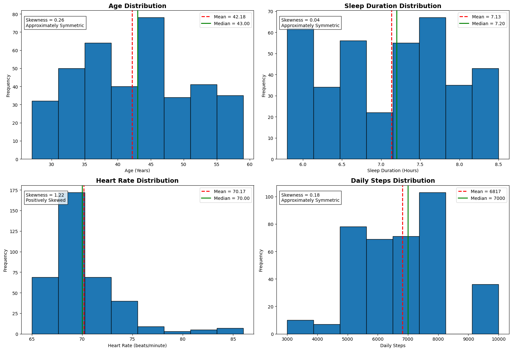
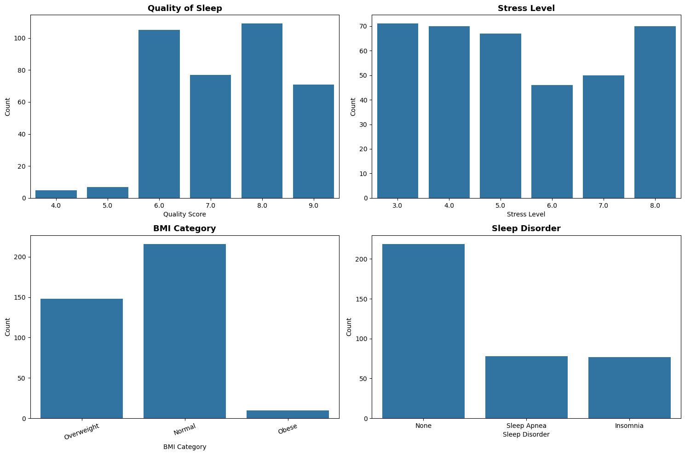
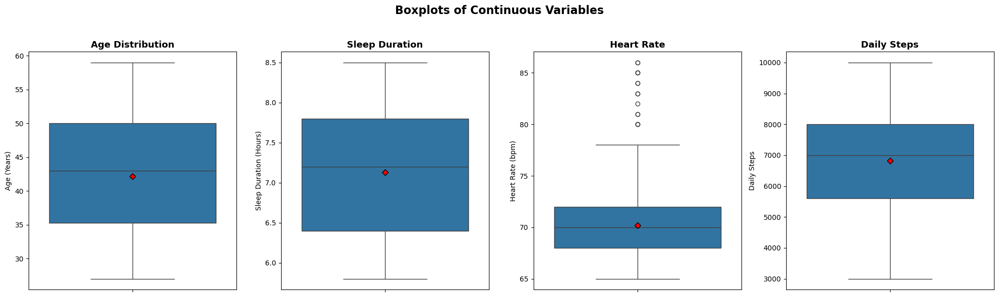
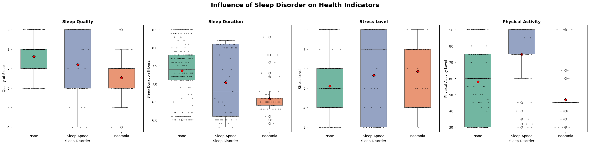
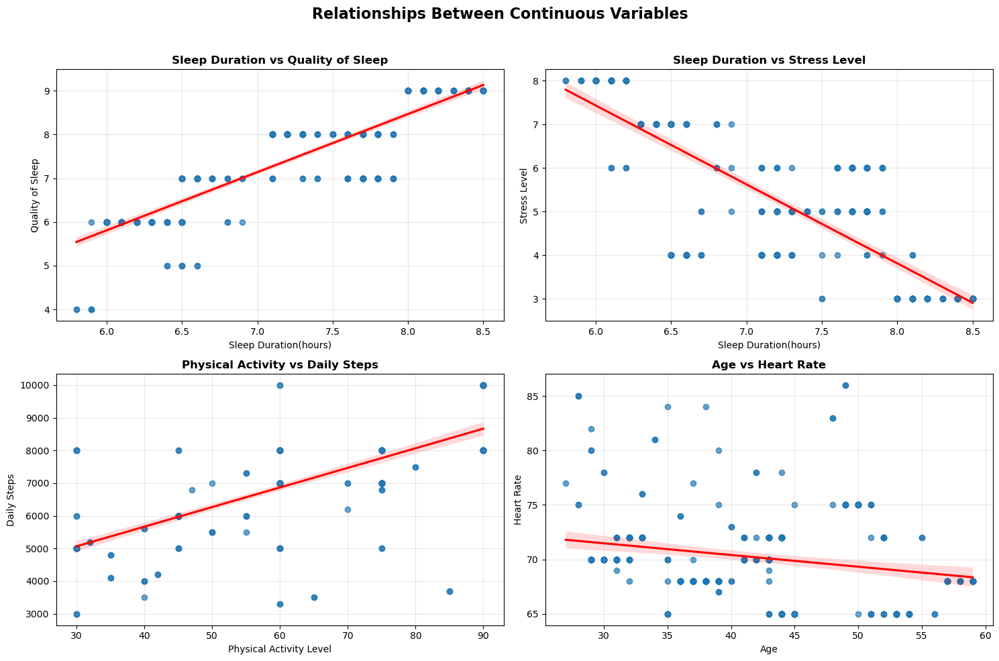
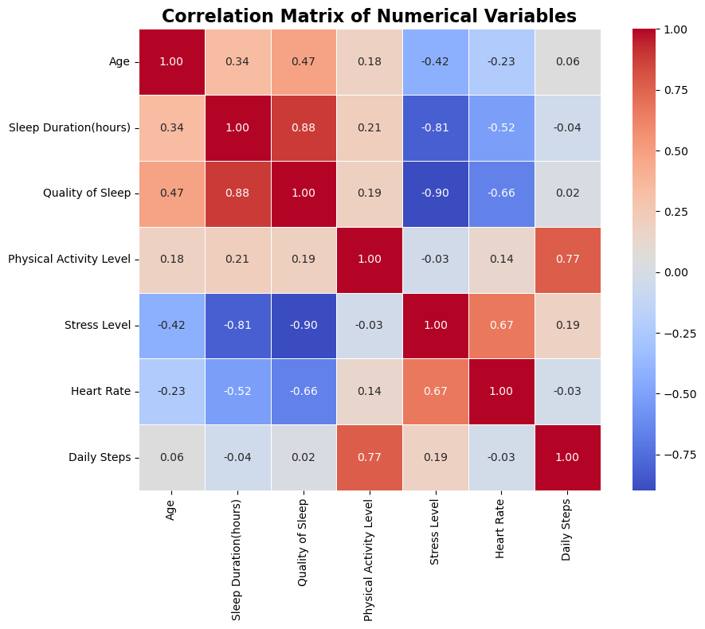

# Exploratory Data Analysis of Sleep Health and Lifestyle

A comprehensive exploratory data analysis (EDA) of the Sleep Health and Lifestyle dataset using Python. This project explores the distribution of health variables, relationships between lifestyle factors, and the influence of sleep disorders on sleep quality, stress level, physical activity, and other health indicators through statistical analysis and data visualization.

> **Academic context:** This project was prepared for the course *DLBDSEDAV01 – Exploratory Data Analysis and Visualization* (IU International University of Applied Sciences), Written Assignment, Task 1: *Visually Exploring a Data Set*.

## Project Overview

The objective of this project is to perform an Exploratory Data Analysis (EDA) on a sleep health dataset to identify patterns, relationships, and trends among sleep habits, physical activity, stress level, heart rate, and sleep disorders.

The analysis follows a structured EDA workflow, including:

- Data loading and inspection
- Data cleaning
- Data preprocessing
- Univariate analysis
- Bivariate analysis
- Correlation analysis
- Visualization
- Summary of findings

## Dataset

The project uses the **Sleep Health and Lifestyle Dataset**, which contains information about sleep duration, sleep quality, physical activity, stress level, BMI category, heart rate, daily steps, occupation, age, gender, and sleep disorders.

### Dataset Features

- Person ID
- Gender
- Age
- Occupation
- Sleep Duration
- Quality of Sleep
- Physical Activity Level
- Stress Level
- BMI Category
- Blood Pressure
- Heart Rate
- Daily Steps
- Sleep Disorder

## Tools and Libraries

This project was completed using:

- Python
- Jupyter Notebook
- Pandas
- NumPy
- Matplotlib
- Seaborn

## Repository Structure

```
Sleep-and-Health-EDA/
│
├── Sleep_and_Health.ipynb                 # Complete exploratory data analysis notebook
├── Sleep_health_and_lifestyle_dataset.csv # Dataset used for analysis
├── requirements.txt                       # Python package dependencies
├── README.md                              # Project documentation
│
└── Images/
    ├── 01_histograms_continuous_variables.png
    ├── 02_count_plots_discrete_categorical.png
    ├── 03_boxplots_continuous_variables.png
    ├── 04_boxplots_by_sleep_disorder.png
    ├── 05_scatter_plots_with_regression.png
    └── 06_correlation_matrix.png
```
## Analysis Workflow

The exploratory data analysis (EDA) was carried out using a structured workflow to ensure a thorough understanding of the dataset.

### Data Inspection
- Loaded the dataset into a Pandas DataFrame.
- Examined the dataset structure, dimensions, and data types.
- Checked for missing values and duplicate records.
- Generated descriptive statistics for numerical variables.

### Data Cleaning
- Verified that the dataset contained no duplicate records.
- Confirmed that the "None" values in the **Sleep Disorder** column represent participants without a diagnosed sleep disorder rather than missing data.
- Ensured all variables were stored using appropriate data types.

### Exploratory Data Analysis

The following visualizations were created:

- Histograms for continuous variables
- Count plots for categorical variables
- Box plots for continuous variables
- Box plots comparing health indicators by sleep disorder
- Scatter plots with regression lines
- Correlation matrix (heatmap)

### Interpretation

Each visualization was interpreted to identify distributions, trends, outliers, and relationships among the variables.

## Visualizations


### 1. Distributions of the continuous variables

Histograms of age, sleep duration, heart rate and daily steps. The red dashed line is the mean, the green line the median, and each panel shows the skewness. Heart rate is clearly right-skewed (1.22); the others are approximately symmetric. The histograms also show a dip in sleep duration near 7 hours and a separate group of people at exactly 10,000 steps.



### 2. Discrete and categorical variables

Count plots of sleep quality, stress level, BMI category and sleep disorder. Sleep quality is mostly rated 6 to 9 (8 is the most common score), stress is spread fairly evenly across 3 to 8, 216 people have normal weight, 148 are overweight and only 10 are obese, and 219 people have no sleep disorder (78 have sleep apnea, 77 insomnia).



### 3. Box plots and outliers

Box plots of age, sleep duration, heart rate and daily steps. The red diamond marks the mean. Only heart rate has points beyond the whiskers: 15 participants are above the upper fence of 78 beats per minute.



### 4. Comparison by sleep disorder

Sleep quality, sleep duration, stress level and physical activity for people with no disorder, sleep apnea and insomnia (box plots with every participant overlaid as a dot). People with a disorder sleep less, rate their sleep lower and report more stress. Physical activity is lowest in the insomnia group and highest in the sleep apnea group.



### 5. Relationships between variables

Scatter plots with regression lines: sleep duration vs sleep quality (r = 0.88), sleep duration vs stress (r = −0.81), physical activity vs daily steps (r = 0.77) and age vs heart rate (r = −0.23).



### 6. Correlation matrix

Pearson correlations between all numeric variables. The strongest relationships are sleep quality and stress (−0.90), sleep duration and sleep quality (0.88), sleep duration and stress (−0.81), and physical activity and daily steps (0.77).



## Key Findings

The exploratory analysis revealed several important relationships:

- Sleep duration has a strong positive relationship with sleep quality.
- Sleep duration is strongly negatively associated with stress level.
- Physical activity level is positively related to daily steps.
- Higher stress levels are generally associated with poorer sleep quality.
- Participants with sleep disorders tend to have lower sleep quality and shorter sleep duration compared to participants without sleep disorders.
- Heart rate shows a moderate positive relationship with stress level.
- Most continuous variables showed approximately symmetric distributions, while heart rate exhibited slight positive skewness.

## Skills Demonstrated

This project demonstrates the following technical skills:

- Exploratory Data Analysis (EDA)
- Data Cleaning and Preparation
- Data Visualization
- Statistical Interpretation
- Correlation Analysis
- Python Programming
- Pandas
- NumPy
- Matplotlib
- Seaborn
- Jupyter Notebook
- Markdown Documentation
- GitHub Project Organization

## How to Run the Project

To explore this project on your local machine:

### 1. Clone the repository

```bash
git clone https://github.com/Lightroy23/Sleep-Health-EDA.git
```

### 2. Navigate to the project folder

```bash
cd Sleep-Health-EDA
```

### 3. Install the required dependencies

```bash
pip install -r requirements.txt
```

### 4. Launch Jupyter Notebook

```bash
jupyter notebook
```

### 5. Open the notebook

Open **Sleep_and_Health.ipynb** and run the cells sequentially to reproduce the analysis and visualizations.

## Requirements

This project was developed using the following Python libraries:

- pandas
- numpy
- matplotlib
- seaborn
- jupyter

Install all required packages with:

```bash
pip install -r requirements.txt
```

## Future Improvements

Possible extensions of this project include:

- Perform statistical hypothesis testing to validate observed patterns.
- Develop machine learning models to predict sleep disorders.
- Build an interactive dashboard using Power BI, Tableau, or Plotly.
- Explore feature engineering techniques to improve predictive performance.
- Incorporate additional health and lifestyle datasets for comparative analysis.

## Author

**Helen Chika Nzute (Umeano)**

Student ID: 102401286 Course: DLBDSEDAV01 - Explorative Data Analysis and Visualization

- **GitHub:** https://github.com/Lightroy23

## Acknowledgements

This project was completed as part of my data science learning journey and demonstrates the application of Exploratory Data Analysis (EDA) techniques using Python.

The analysis was conducted using the **Sleep Health and Lifestyle Dataset**, with visualization and analysis performed using **Pandas**, **NumPy**, **Matplotlib**, and **Seaborn**.

## License

This project is provided for **educational and portfolio purposes only**.

It was completed as part of the **DLBDSEDAV01 – Explorative Data Analysis and Visualization** course at **IU International University of Applied Sciences**.

The dataset remains the property of its original creators. Please refer to the dataset source for its specific licensing terms.

You are welcome to view and learn from this project. If you use or reference any part of this work, please provide appropriate attribution.